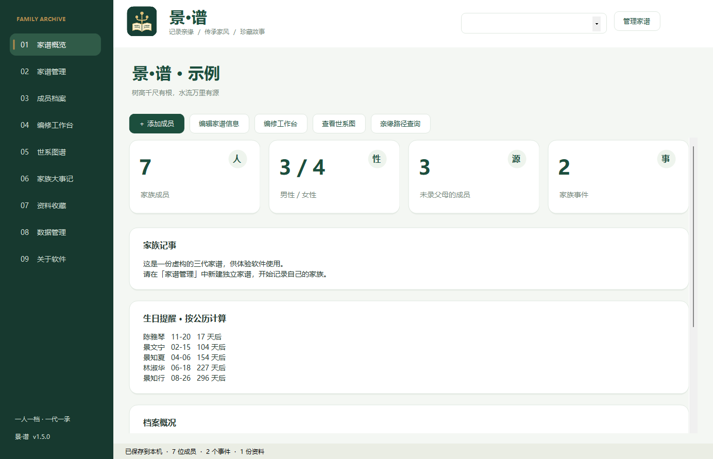
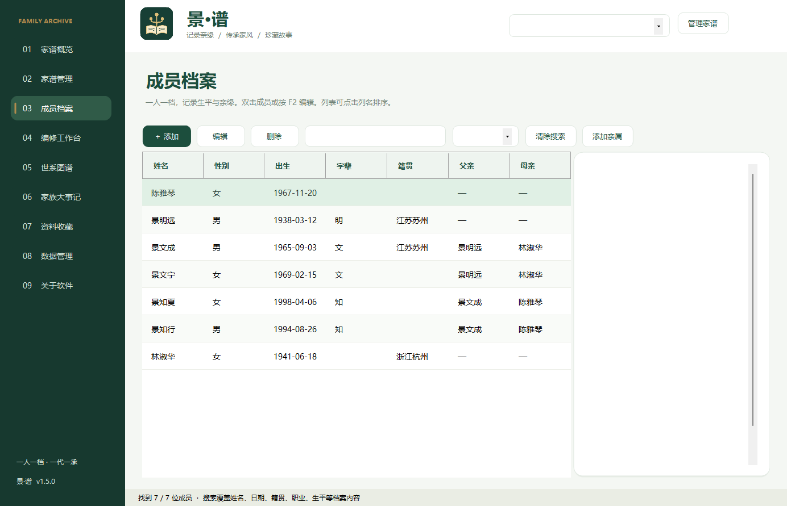
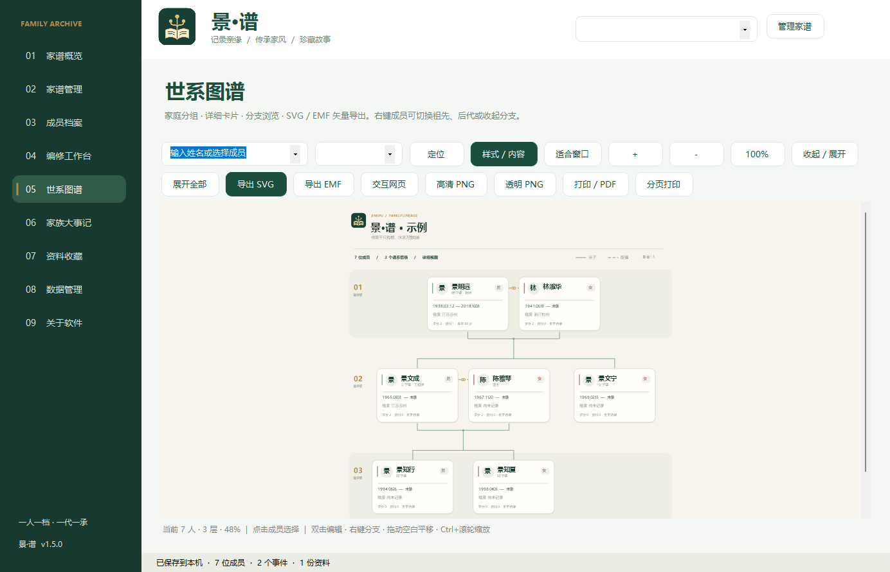
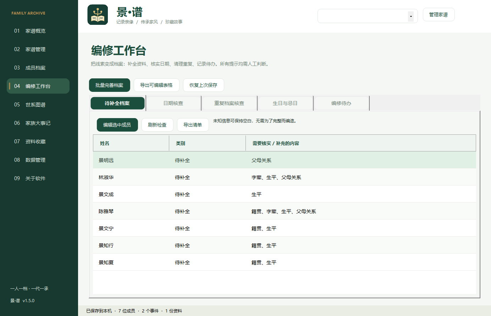
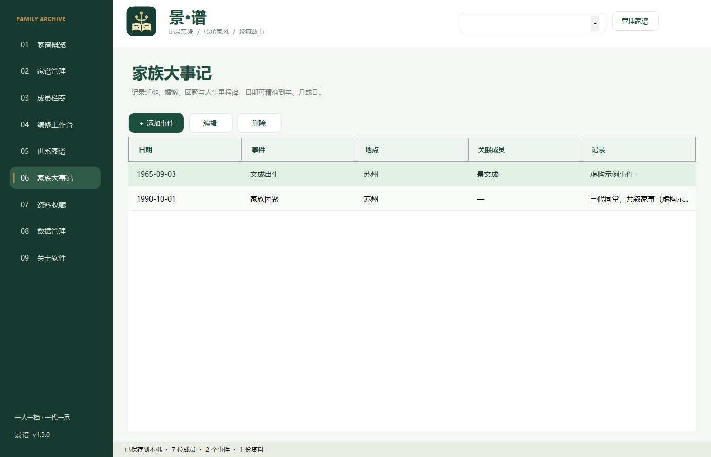
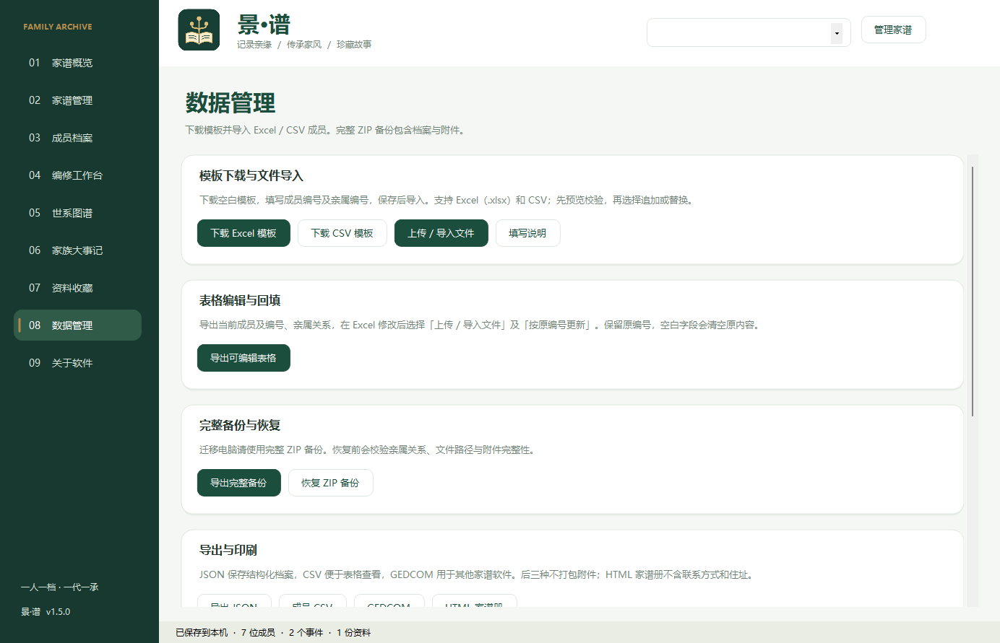
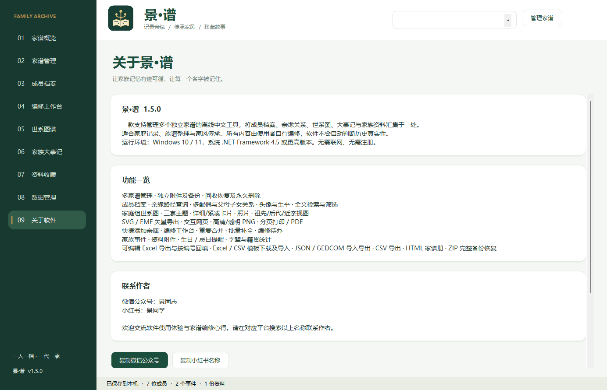

<p align="center">
  
</p>

<h1 align="center">景·谱 JingGenogram</h1>

<p align="center">
  
  
  
  
</p>

<p align="center">一款离线、开源的中文家谱档案与世系图工具，让家族记忆有迹可循，让每一个名字被记住。</p>

---

## 简介 · Introduction

**景·谱** 是一款支持管理多个独立家谱的离线中文工具，将成员档案、亲缘关系、世系图、大事记与家族资料汇集于一处。适合家庭记录、族谱整理与家风传承。所有内容由使用者自行编修，软件不会自动判断历史真实性。

JingGenogram is an offline, open-source Chinese genealogy & family-tree manager. It keeps member profiles, kinship, pedigree diagrams, family chronicles and archives in one place — fully offline, no account or network required.

> 🔗 项目地址 / Repository: **https://github.com/jingpanlong/JingGenogram**
> 软件「关于」页也内置了该地址，可一键打开或复制。

---

## 功能一览 · Features

- **多家谱管理**：每份家谱独立目录，含独立附件与备份；支持新建、复制、切换、重命名、从 ZIP 新增。
- **回收与永久删除**：回收区可恢复；1.5 新增「永久删除选中」与「清空回收区」，需手工输入完整名称确认，防误删。
- **成员档案**：头像、生平、多配偶与父母子女关系、全文检索与筛选。
- **亲缘查询**：查询两人之间的亲缘路径。
- **世系图谱**：家庭组世系图，三套主题（墨印 / 玉笺 / 黛青）、详细 / 紧凑卡片、照片、祖先 / 后代 / 近亲视图；支持 SVG / EMF 矢量导出、交互网页、高清 / 透明 PNG、分页打印 / PDF。
- **编修工作台**：快捷添加亲属、重复合并、批量补全、编修待办。
- **家族大事记与资料收藏**：生日 / 忌日提醒、字辈与籍贯统计、资料附件管理。
- **数据互通**：可编辑 Excel 导出与按编号回填，Excel / CSV 模板下载与导入，JSON / GEDCOM 导入导出，CSV 导出，HTML 家谱册，ZIP 完整备份恢复。
- **完全离线**：不上传任何家谱内容，无需联网、无需注册。

---

## 界面预览 · Screenshots

| 家谱概览 | 成员档案 | 世系图谱 |
| --- | --- | --- |
|  |  |  |

| 编修工作台 | 家族大事记 | 数据管理 |
| --- | --- | --- |
|  |  |  |

> 「关于软件」页已内置 GitHub 仓库地址，可一键打开或复制：
>
> 

---

## 下载与安装 · Download

前往 **[Releases](https://github.com/jingpanlong/JingGenogram/releases)** 页面下载最新版本：

| 文件 | 说明 |
| --- | --- |
| `JingGenogram-1.5.0-setup.exe` | 安装版（推荐）：含开始菜单入口与卸载程序 |
| `JingGenogram-1.5.0.exe` | 单文件版：无需安装，双击即运行 |

- **运行环境**：Windows 10 / 11，系统自带 .NET Framework 4.5 或更高版本（无需额外运行库）。
- **完全离线**：无需联网、无需注册。
- 下载后建议核对 `SHA256SUMS.txt` 中的校验值。

---

## 从源码构建 · Build from Source

源码使用系统自带的 Windows .NET Framework C# 编译器生成，无第三方运行库依赖。

```powershell
# 在 Windows PowerShell 中，进入源码目录后执行：
cd src
powershell -ExecutionPolicy Bypass -File .\build.ps1
```

构建产物位于 `src/dist/`：

- `JingFamily.exe` —— 单文件主程序
- `JingFamily-Setup.exe` —— 内嵌主程序的安装包

> 构建需要 `JingPu-icon-256.png`（已随仓库提供），`build.ps1` 会自动引用。

---

## 使用与数据说明 · Data & Privacy

- 本软件**不上传**家谱内容。请在录入在世亲属的联系方式、住址、照片前征得对方同意。
- 完整备份及 JSON 含个人档案，未加密，请保存在可信位置；CSV 亦包含联系方式。
- 生日按公历计算；日期未知可只填年或年月。
- GEDCOM 以 UTF-8 读写，兼容基础人物和家庭关系。
- 系统打印可选择已安装的 PDF 打印机；附件需系统中对应的程序打开。
- 卸载软件默认保留家谱总目录（位于 `%LOCALAPPDATA%\JingFamily`）。

---

## 开源协议 · License

本项目以 **MIT 协议** 开源，详见 [LICENSE](LICENSE)。

---

## 联系作者 · Contact

- 微信公众号：景同志
- 小红书：景同学

欢迎交流软件使用体验与家谱编修心得。也可直接在 GitHub 提交 Issue 或参与改进。
